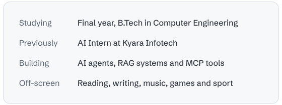
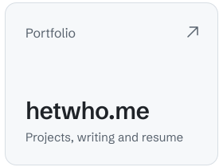
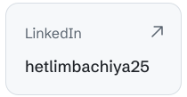
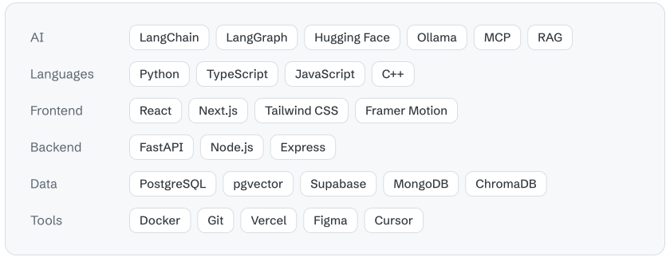
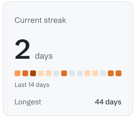
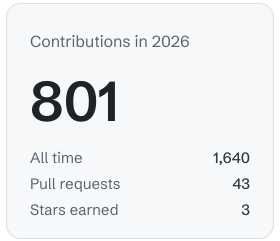
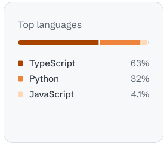

<!-- Generated by scripts/build.py from profile.toml. Edit profile.toml, not this file. -->

<picture><source media="(prefers-color-scheme: dark)" srcset="https://raw.githubusercontent.com/het2576/het2576/HEAD/assets/dark/hero.svg"></picture> 
<picture><source media="(prefers-color-scheme: dark)" srcset="https://raw.githubusercontent.com/het2576/het2576/HEAD/assets/dark/now.svg"></picture><a href="https://hetwho.me"><picture><source media="(prefers-color-scheme: dark)" srcset="https://raw.githubusercontent.com/het2576/het2576/HEAD/assets/dark/portfolio.svg"></picture></a> 
<a href="https://linkedin.com/in/hetlimbachiya25"><picture><source media="(prefers-color-scheme: dark)" srcset="https://raw.githubusercontent.com/het2576/het2576/HEAD/assets/dark/link-1.svg"></picture></a><a href="https://x.com/hettt_25"><picture><source media="(prefers-color-scheme: dark)" srcset="https://raw.githubusercontent.com/het2576/het2576/HEAD/assets/dark/link-2.svg"></picture></a><a href="https://medium.com/@hett25"><picture><source media="(prefers-color-scheme: dark)" srcset="https://raw.githubusercontent.com/het2576/het2576/HEAD/assets/dark/link-3.svg"></picture></a><a href="https://drive.google.com/file/d/1SRXs4w_SCHOayRpWGqhyYIf1JujirXe5/view?usp=sharing"><picture><source media="(prefers-color-scheme: dark)" srcset="https://raw.githubusercontent.com/het2576/het2576/HEAD/assets/dark/link-4.svg"></picture></a> 
<picture><source media="(prefers-color-scheme: dark)" srcset="https://raw.githubusercontent.com/het2576/het2576/HEAD/assets/dark/stack.svg"></picture> 
<picture><source media="(prefers-color-scheme: dark)" srcset="https://raw.githubusercontent.com/het2576/het2576/output/stats-streak-dark.svg"></picture><picture><source media="(prefers-color-scheme: dark)" srcset="https://raw.githubusercontent.com/het2576/het2576/output/stats-activity-dark.svg"></picture><picture><source media="(prefers-color-scheme: dark)" srcset="https://raw.githubusercontent.com/het2576/het2576/output/stats-languages-dark.svg"></picture> 
<picture><source media="(prefers-color-scheme: dark)" srcset="https://raw.githubusercontent.com/het2576/het2576/output/contrib-dark.svg"></picture> 
<a href="mailto:hetlimbachiya257@gmail.com"><picture><source media="(prefers-color-scheme: dark)" srcset="https://raw.githubusercontent.com/het2576/het2576/HEAD/assets/dark/footer.svg"></picture></a>  

